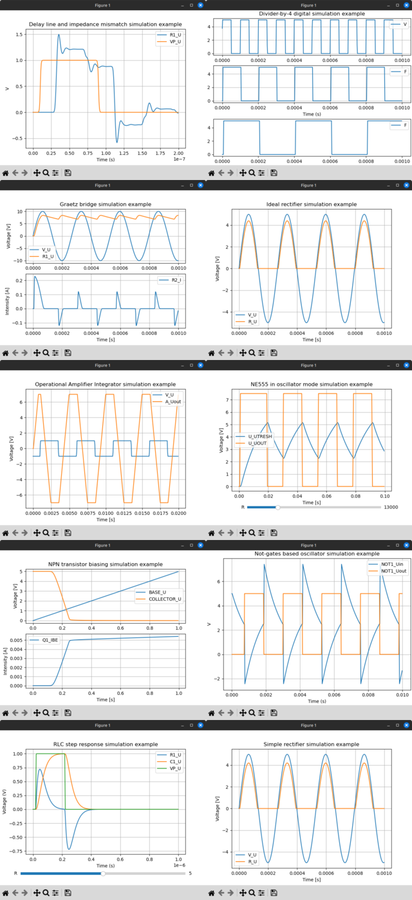
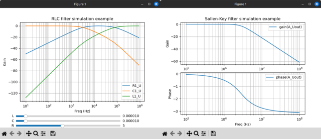

## ASysC

**ASysC** (Analog System Compiler) is a circuit compiler built on **LightCAS**,
a lightweight computer algebra system. Circuit equations are written in a
compact rule-based language, compiled to Python models, and simulated for
transient or AC behavior.

The component rules describe physical relationships. For example, a resistor
connects its voltage and current using Ohm's law:

```text
NAME.CR(@1, @2, R) := {
    NAME.U = ACROSS(@1, @2);
    NAME.I = THROUGH(@1, @2);
    NAME.U = R * NAME.I
};
```

The `@1` and `@2` parameters represent the resistor terminals. Circuit netlists
instantiate components and connect their terminals; examples are available in
the [examples](examples) directory, and component definitions are in
[components.rule](rules/components.rule).

## Project layout

| Path | Contents |
| --- | --- |
| [src/lib/](src/lib) | LightCAS library and expression engine |
| [src/app/](src/app) | ASysC command-line compiler |
| [rules/](rules) | Component, algebra, and evaluation rules |
| [examples/ac/](examples/ac) | AC-analysis circuits and plotting scripts |
| [examples/transient/](examples/transient) | Transient-analysis circuits and plotting scripts |
| [doc/](doc) | Project documentation and figures |

Each example directory normally contains a `.cir` netlist and a
`simulation.py` script. The compiler generates a Python model from the netlist;
the script runs the simulation and plots its results.

## Requirements

- GNU Make
- A C++ compiler: `g++` or `clang++`
- Python 3
- Python packages: NumPy and Matplotlib

On Debian or Ubuntu, install the compiler and Python packages with:

```bash
sudo apt install build-essential python3 python3-numpy python3-matplotlib
```

## Get the source

```bash
git clone https://github.com/analog-system-compiler/asysc.git
cd asysc
```

## Build

Build the compiler and generate the Python models for the examples:

```bash
make -j4
```

The `-j4` option compiles up to four C++ files in parallel; adjust the number
to suit your machine. To remove compiler and generated example outputs before
building again, run:

```bash
make clean
make -j4
```

Optional build settings can be passed as Make variables:

```bash
make USE_CLANG=1       # Build with clang++ instead of g++.
make DEBUG=1           # Include debug symbols and enable assertions.
make TEST=1 bin/asysc  # Enable the built-in LightCAS checks at startup.
```

The `TEST=1` checks run when the resulting `bin/asysc` executable starts.
`make run` below is separate: it runs the example circuit simulations.

## Run the examples

Run every example simulation from the repository root:

```bash
make run
```

To generate the Python models without running the plots, use:

```bash
make -C examples
```

To run one example, first generate its model, then run its script from that
example's directory. For example:

```bash
make -C examples
cd examples/ac/rc_low_pass
python3 simulation.py
```

The plotting scripts open Matplotlib windows; use a graphical session or
configure a non-interactive Matplotlib backend if running without a display.

## Use the compiler directly

The command-line compiler accepts a circuit netlist, a Python output path, and
an analysis type (`ac` or `trans`). For example:

```bash
./bin/asysc \
  -i examples/ac/rc_low_pass/rc_low_pass.cir \
  -o /tmp/rc_low_pass.py \
  -t ac
```

For command-line help, start the compiler without arguments and enter `help`.
Enter `exit` to leave the interactive console.

## Documentation and contributing

The [doc/](doc) directory contains the project documentation. Rule files in
[rules/](rules) define components and symbolic transformations; keep new rule
files consistent with the lowercase naming convention and update
`rules/includes.rule` when adding a rule that should be loaded by default.

Before submitting changes, build the compiler and run the relevant example or
test. The `make header` target updates source license headers.

## License

ASysC is distributed under the GNU General Public License. See the
[LICENSE](LICENSE) file for details.

## Example analyses




