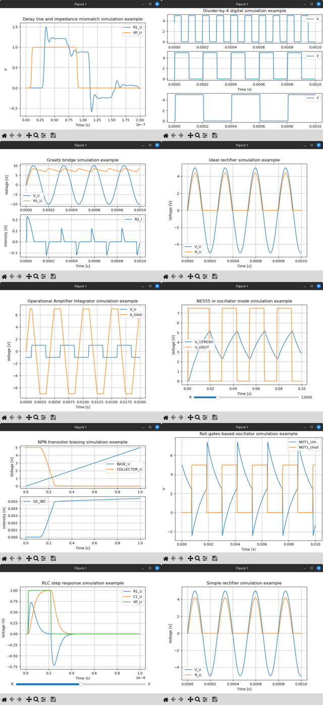
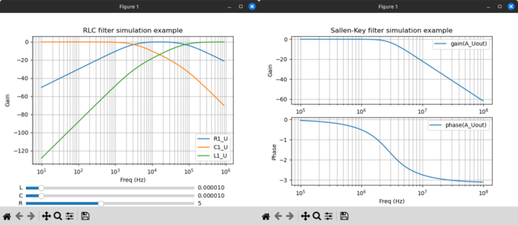

## Introduction ##

**asysc** is an analog system compiler based on the lightweight Computer Algebra System **lightcas**.

Similar to the VHDL-AMS language, ASysC allows you to create your own components using algebraic descriptions.

For instance, consider the resistor declaration:

    NAME.CR(@1,@2,R) := { 
        NAME.U = ACROSS( @1, @2 ); 
        NAME.I = THROUGH( @1, @2 ); 
        NAME.U = R * NAME.I 
    };

Additional component definition examples can be found in the [components.rule](https://github.com/analog-system-compiler/lightcas/blob/3b8b692d76aa31503276b9a10259393b8f68dcf0/rules/components.rule) file and [examples](examples) directories.

## Requirements

### C++ requirement
- g++ or clang
- make
  
### Python requirements
- numpy
- matplotlib
  
## Getting source code
```bash
git clone https://github.com/analog-system-compiler/asysc.git
cd asysc
```

## Code compilation

```bash
make clean
make -j4
```

LightCAS source code and build configuration are in the project root. Its
documentation and license remain in `lightcas/`. The `-j4` option builds C++
sources in parallel; adjust it to match the number of available CPU cores.

## Run all tests

```bash
make run
```

## Run a specific test

To execute a particular test, type:

```bash
make -C examples
cd examples/<directory>
python3 simulation.py
```

## License

This project is licensed under the GNU General Public License - see the [LICENSE](LICENSE) file for details.

## Examples

### Some transient analysis examples



### Some AC analysis examples


